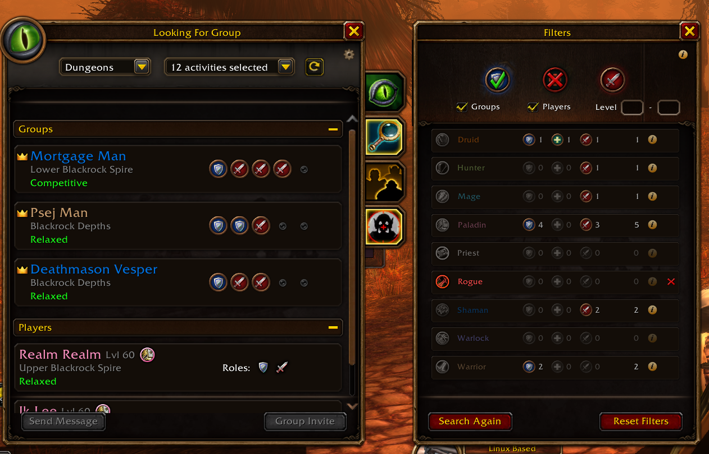
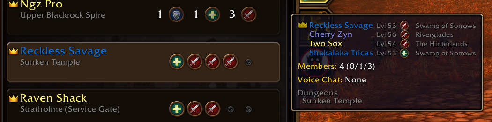
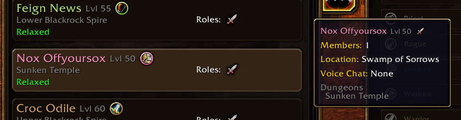
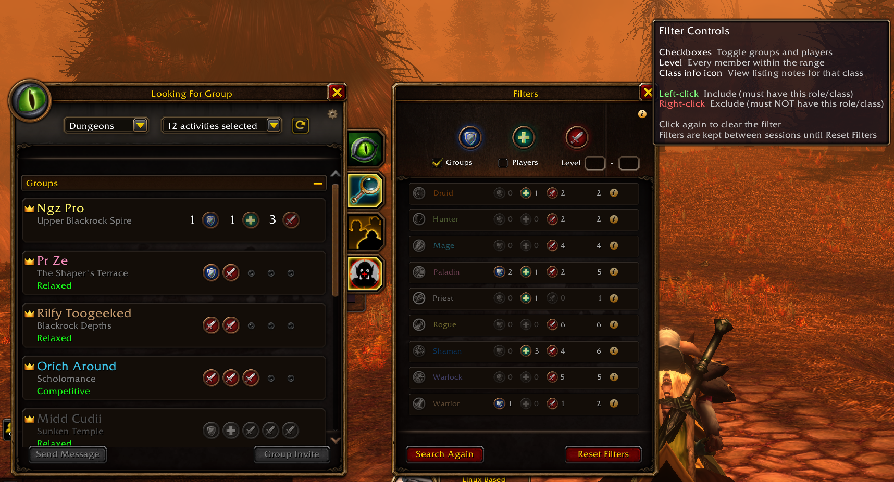

# LFG Expanded

**LFG Expanded** adds role, class and level filters to the Group Finder and shows where listed players are.

Built for **WoW Forever**. It is no longer updated for Classic Anniversary: v1.0.3 is the last Anniversary release.

---

## Features

### Filters panel

- **Filters tab** - A side tab under Blizzard's Create Listing, Browse and Who tabs opens and closes the panel. The panel also opens by itself when you choose Dungeons or Raids, except for the first choice after you close it.
- **Role filters** - Tank, Healer and DPS. Left-click to require, right-click to exclude, click again to clear.
- **Class filters** - One row per class with the same controls. Each row counts the listings shown that include that class as tank, healer or DPS. A class appears only if a listing that a click could show includes it, or if it has a filter set.
- **Include and exclude rules** - Exclusions apply first. Includes combine with OR: requiring Healer and Hunter shows every listing with a healer or a hunter. A group is excluded when any member has an excluded role or class. A solo player is excluded when their class is excluded, and by role only when all of their listed roles are excluded.
- **Groups and Players** - Checkboxes that show or hide group listings and solo players.
- **Level range** - A minimum and maximum level that every member of a listing must be within. Leave a box empty for no limit. Press Enter or click away to apply, Escape to undo.
- **Sorting** - While a role or class filter is set, or Groups or Players is unchecked, groups are listed first and solo players are grouped by class.
- **Class notes** - The info icon on a class row lists the comments of the listings shown whose leader or solo player is that class, up to 20.
- **Saved filters** - Filters are kept between sessions until you click Reset Filters.

### Locations

- **Solo players** - The listing tooltip shows the player's zone on a Location line.
- **Groups** - The listing tooltip shows each member's zone after their name once it is known. The game sends only the leader's zone with a listing; left-click the listing to look up the other members, one per click (see Looking up group members below).
- **Zones, not subzones** - A subzone is shown as its zone, so Nightmare Vale shows as Tirisfal Glades. Names that belong to more than one zone (border lakes, rivers, passes and seas) and names that are also a zone of their own (mostly dungeons and their entrances) are shown as the game reports them.

---

## Usage

Open the Looking For Group window, choose Dungeons or Raids, and search. The Filters panel opens beside the window. Its info icon lists the controls.

### Looking up group members

Each left-click on a group listing looks up one member with `/who`, starting with the first member whose zone is unknown. Only that member's row shows a status:

- **Click to look up** - The next click looks up this member.
- **Looking up...** - Waiting for the server's answer.
- **Wait Ns** - Counts down until the next lookup can be sent. Clicks during the countdown send nothing.
- **No answer, click to retry** - The server did not answer. Other members are looked up before this one is tried again.

A lookup ends with the member's zone or **Not found** (for example, the player went offline). Results are kept for 5 minutes.

Limits:

- The game lets an addon send `/who` only from a click, one query per click, and the server drops queries sent too soon after another without saying so. The addon waits 5 seconds between lookups. A lookup can still go unanswered; click again to retry.
- The lookup's lines are kept out of chat. A `/who` you type yourself shows as usual.
- Groups with more than 10 members get no lookups, because Blizzard's tooltip does not list their members.
- Clicking a listing also selects it, as it does without the addon.

If the game restricts listing details, filtering pauses with a message and Blizzard's results stay visible. It resumes with the next readable search result.

---

## Configuration Options

There is no options window and no slash command. Everything is set in the Filters panel:

- Role filters: Tank, Healer, DPS
- Class filters: Druid, Hunter, Mage, Paladin, Priest, Rogue, Shaman, Warlock, Warrior
- Groups and Players checkboxes
- Level range
- Search Again and Reset Filters buttons

---

## Classic Anniversary

LFG Expanded is no longer updated for Classic Anniversary. v1.0.3 is the last Anniversary release and stays available on CurseForge. Its TOC predates patch 2.5.6, so the 2.5.6 client loads it only with **Load out of date AddOns** enabled in the AddOn List.

---

## License

MIT License - Open source and free to use.

---

## Feedback & Issues

Found a bug or have a suggestion? Reach me on Discord: `_cmos` or open an issue on GitHub: https://github.com/clearcmos/LFGExpanded
